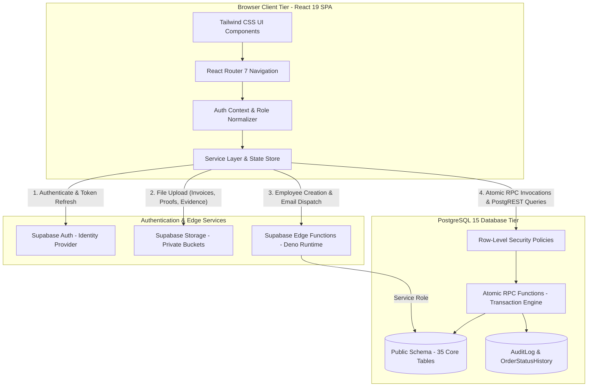
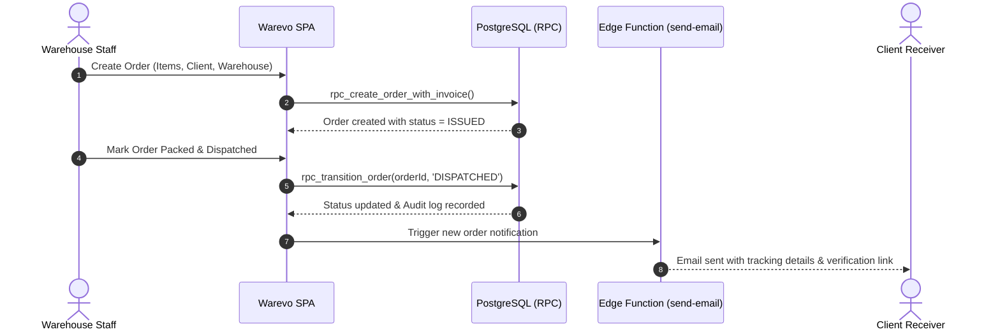
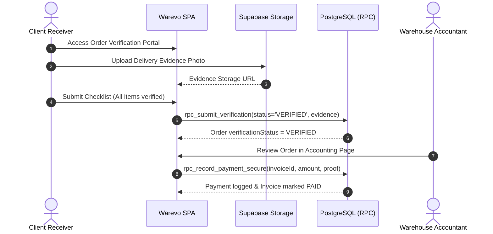

# Warevo System Architecture

This document outlines the system architecture, component relationships, data flow boundaries, and operational layers of **Warevo — Multi-Tenant Warehouse Management System (WMS)**.

---

## 1. High-Level Architectural Diagram



---

## 2. Core Architectural Components

### 2.1 Single Page Application (SPA) Tier
- **Framework**: React 19 with Vite 6.4 bundler.
- **Client Routing**: React Router 7 (`react-router-dom`) with declarative protected route guards (`<ProtectedRoute allowedRoles={[...]} />`).
- **Styling System**: Tailwind CSS 3.4 with custom palette (slate-950 dark theme), Lucide React iconography, and Recharts operational data visualizations.
- **Client Document Processing**: Client-side PDF rendering via `pdfjs-dist` worker and image compression via `browser-image-compression` to handle mobile delivery proof uploads efficiently.

### 2.2 Identity & Access Tier
- **Supabase Auth**: Issues and validates JWT session tokens.
- **Profile Resolution**: The frontend maps `auth.uid()` against `public."User"."supabaseUserId"` to establish tenant ownership, role definitions, and business profile.
- **Status Gate**: Accounts in `INACTIVE` or `SUSPENDED` status are terminated at the authentication layer before accessing application routes.

### 2.3 PostgreSQL Engine & Transaction Tier
Rather than delegating multi-table transactional guarantees to client JavaScript, all high-stakes warehouse actions execute directly inside PostgreSQL:
- **Atomic Operations**: Order status transitions, stock movements, and delivery verification submissions are handled by PostgreSQL stored procedures (`SECURITY DEFINER`).
- **Data Invariants**: Enforces business rules (e.g., negative stock protection, dispatch immutability, payment-before-verification prevention) at the database layer.
- **Audit Logging**: Every state change triggers synchronous records in `OrderStatusHistory` and `AuditLog`.

### 2.4 Serverless Edge Function Tier
Edge Functions run on Deno within Supabase:
1. `create-employee`: Securely provisions new warehouse and client staff by invoking Supabase Admin API and mapping local user records without exposing service role keys to browsers.
2. `send-email`: Formats and delivers transactional email notifications (order dispatch, verification confirmation, payment receipt) via Resend.

---

## 3. Data Flow Pathways

### 3.1 Order Lifecycle & Dispatch Flow


### 3.2 Client Delivery Verification & Invoicing Flow


---

## 4. Multi-Tenant Data Isolation Architecture

```text
[ Tenant ] (e.g., "Apex Logistics" / "Pure Aura")
   │
   ├── [ Warehouse ] (Physical facility)
   │     └── [ WarehouseLocation ] (Aisles, Racks, Bins)
   │           └── [ Inventory ] ── [ Product ]
   │                 └── [ InventoryMovement ] (Immutable ledger)
   │
   ├── [ User ] (Warehouse Owner, Staff, Accountant)
   │
   └── [ Client ] (Customer Company)
         ├── [ ClientEmployee ] (MD, General Manager, Receiver, Accountant)
         │     └── [ RoleDefinition ] ── [ RolePermission ]
         │
         └── [ Order ]
               ├── [ OrderItem ]
               ├── [ OrderStatusHistory ]
               ├── [ OrderComment ]
               ├── [ DeliveryVerification ] ── [ DeliveryVerificationItem ]
               └── [ Invoice ]
                     ├── [ InvoiceItem ]
                     └── [ Payment ] (Transaction receipt & proof)
```

### Isolation Guarantees:
1. **Foreign Key Binding**: Operational tables must link to a valid `tenantId`.
2. **Row-Level Security**: All `SELECT`, `UPDATE`, and `DELETE` queries are filtered through `can_access_tenant("tenantId")`.
3. **Cross-Tenant Prevention**: If Tenant A sends a request containing Tenant B's order ID, PostgreSQL returns empty rows or raises an access error.
