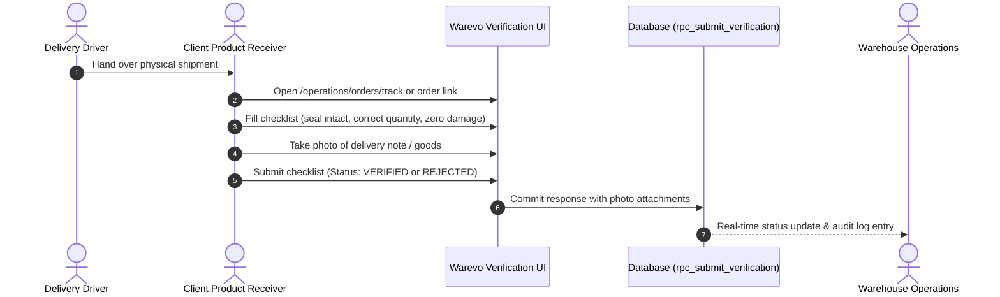

# Warevo Order Workflow & Delivery Verification

This document specifies the order lifecycle, dispatch mechanics, client delivery verification checklists, and invoicing workflows implemented in **Warevo — Multi-Tenant Warehouse Management System (WMS)**.

Implementation sources:
- Frontend state machine: [`src/lib/orderWorkflow.ts`](file:///d:/Dev/warehouse_management/src/lib/orderWorkflow.ts)
- Service layer methods: [`src/lib/services.ts`](file:///d:/Dev/warehouse_management/src/lib/services.ts)
- Atomic RPC procedures: `rpc_transition_order`, `rpc_submit_verification`, `rpc_update_order_before_dispatched`, `rpc_add_delivery_evidence`

---

## 1. Complete Order Lifecycle State Machine

Warevo models order progression with deterministic state transitions:

```text
  [ DRAFT ] ────────► [ ISSUED ] ────────► [ PROCESSING ] ────────► [ DISPATCHED ]
                          │                       │                      │
                          ▼                       ▼                      ▼
                     [ CANCELLED ]           [ CANCELLED ]          [ DELIVERED ]
                                                                         │
                                                                         ▼
                                                           [ DELIVERY VERIFICATION ]
                                                            ┌────────────┴───────────┐
                                                            ▼                        ▼
                                                      [ VERIFIED ]              [ REJECTED ]
                                                            │                        │
                                                            ▼                        ▼
                                                     [ FINAL INVOICE &        [ DISCREPANCY
                                                        PAYMENT OPEN ]          INVESTIGATION ]
```

### Valid Transition Matrix

| From Status | Allowed Next Statuses | Actor / Trigger |
|:------------|:----------------------|:----------------|
| `DRAFT` | `ISSUED`, `CANCELLED` | Warehouse Staff, Warehouse Owner |
| `ISSUED` | `PROCESSING`, `CANCELLED` | Warehouse Staff (Picking begins) |
| `PROCESSING` | `DISPATCHED`, `CANCELLED` | Warehouse Staff (Packing complete, carrier assigned) |
| `DISPATCHED` | `DELIVERED`, `CANCELLED` (Admin only) | Carrier delivery confirmed |
| `DELIVERED` | None (Final operational state) | Awaiting Delivery Verification Checklist |
| `CANCELLED` | Terminal State | Cannot be re-opened |

---

## 2. Order Immutability Pre/Post Dispatch

A critical business rule enforced in database migration `20261018_000000_order_lifecycle_verification_evidence.sql`:

1. **Before Dispatch (`ISSUED` / `PROCESSING`)**:
   - Authorized warehouse staff can edit line item quantities, add products, or delete mistakenly created orders via `rpc_update_order_before_dispatched` and `rpc_delete_order_before_dispatched`.
2. **After Dispatch (`DISPATCHED` / `DELIVERED`)**:
   - Order items, quantities, and pricing become **strictly immutable**.
   - Any modifications must be processed through order cancellation or credit notes, preventing discrepancies with issued shipping manifests and E-Way bills.

---

## 3. Client Delivery Verification Process

When goods arrive at the client facility, the client receiver completes delivery verification:



### Verification Checklist Criteria:
- **Package Seal Intact**: Confirms tamper-evident packaging is unbroken.
- **Physical Damage Check**: Inspects for exterior box crushing or liquid stains.
- **Line Item Quantity Check**: Compares physically received units with billed items.
- **Delivery Document & E-Way Bill**: Confirms driver invoice copy matches electronic record.

### Outcomes:
- **`VERIFIED`**: Full receipt confirmed. Unlocks final invoice processing and payment authorization.
- **`PARTIAL`**: Partial quantity accepted; shortages noted in `VerificationResponse`.
- **`REJECTED`**: Shipment refused due to significant damage or incorrect delivery. Triggers immediate alert to warehouse team.

### Administrative Override & Evidence Appending:
If a client is unable to verify electronically (e.g., connectivity loss or physical sign-off only), authorized warehouse managers can record a warehouse-side verification override via `rpc_submit_verification`. The database tags this override with `source = 'WAREHOUSE'` and logs the staff user's ID for accountability.

---

## 4. Invoicing & Payment Gating

Warevo guarantees that invoices and payments align with verified physical fulfillment:

1. **Draft Invoices**: Can be generated upon order creation for internal estimation.
2. **Final Invoice Generation**: Blocked until order verification status is `VERIFIED`.
3. **Payment Proof Submission**:
   - Client accountants upload payment confirmation slips (NEFT, RTGS, IMPS, Cheque).
   - Images are compressed client-side to optimize upload speeds.
   - Proof documents are stored in private Supabase bucket `payment-proofs`.
   - Warehouse accountants review and mark invoice payment status as `PAID`.
