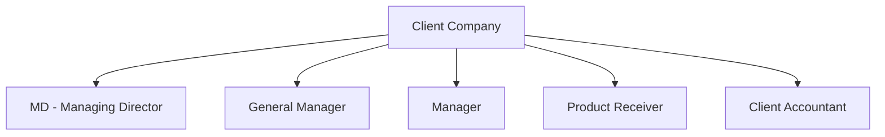

# Warevo — Roles & Permission Model

This document outlines the user roles, access scopes, and granular permission boundaries implemented in **Warevo — Multi-Tenant Warehouse Management System (WMS)**.

Permissions are derived directly from the source code definitions in [`src/lib/permissions.ts`](file:///d:/Dev/warehouse_management/src/lib/permissions.ts), [`src/types/index.ts`](file:///d:/Dev/warehouse_management/src/types/index.ts), and the PostgreSQL database role tables (`RoleDefinition`, `RolePermission`, `Permission`).

---

## 1. System Roles (`Role` Enum)

The primary role hierarchy partitions users into Platform Administrators, Warehouse Personnel, and External Clients:

| Role Identifier | Description & Responsibility | Access Scope | Protected Routes |
|-----------------|------------------------------|--------------|------------------|
| `PLATFORM_ADMIN` | Platform operator and SaaS administrator. | Cross-tenant (global) | `/admin`, `/platform`, all warehouse & operational routes |
| `WAREHOUSE_OWNER` | Executive administrator of a specific warehouse tenant. Full authority over physical inventory, staff, clients, and accounting. | Single tenant | `/dashboard`, `/operations/*`, `/accounting`, `/reports`, `/settings`, `/employees` |
| `WAREHOUSE_MODERATOR` | Operational manager overseeing order fulfillment, stock movement, and client operations. | Single tenant | `/dashboard`, `/operations/orders`, `/operations/inventory`, `/operations/clients`, `/operations/employees` |
| `WAREHOUSE_STAFF` | Floor operations staff handling receiving, picking, packing, and dispatch. | Single tenant | `/dashboard`, `/operations/orders`, `/operations/orders/new`, `/operations/inventory`, `/operations/orders/track` |
| `ACCOUNTANT` | Financial specialist managing accounts receivable, tax calculations, invoice generation, and payment reconciliation. | Single tenant | `/dashboard`, `/operations/orders` (financial view), `/accounting`, `/accounting/invoices/:id`, `/reports` |
| `ACCOUNTS_TEAM` | Subsidiary accounting team with financial review and payment entry capabilities. | Single tenant | Same as `ACCOUNTANT` |
| `CLIENT` | External client contact. Can view their company's orders, track shipments, verify deliveries, and review billing. | Client company within tenant | `/dashboard`, `/operations/orders`, `/orders/:id`, `/operations/orders/track`, `/accounting` (client view) |
| `CLIENT_ACCOUNTANT` | Dedicated external accountant representing a client company. | Client company within tenant | `/dashboard`, `/accounting`, `/accounting/invoices/:id`, `/reports` (client financial view) |

---

## 2. Granular Client Employee Roles (`ClientEmployeeRole` Enum)

For corporate client companies with multi-user teams, Warevo implements granular employee roles with custom permission profiles:

### Granular Client Role Permission Matrix

Derived from `DEFAULT_CLIENT_ROLE_PERMISSIONS` in [`src/lib/permissions.ts`](file:///d:/Dev/warehouse_management/src/lib/permissions.ts):

| Permission Key | Description | MD | GM | Manager | Receiver | Accountant |
|:---------------|:------------|:--:|:--:|:-------:|:--------:|:----------:|
| `ORDERS_VIEW` | View list of orders placed by company | Yes | Yes | Yes | Yes | Yes |
| `ORDERS_CREATE` | Draft and submit new purchase orders | Yes | Yes | Yes | No | No |
| `ORDERS_PROCESS` | Oversee order processing & packing stages | Yes | Yes | Yes | No | No |
| `ORDERS_DISPATCH` | Track dispatch and carrier details | Yes | Yes | Yes | Yes | No |
| `DELIVERY_VERIFY` | Complete delivery verification checklists & upload proof | Yes | Yes | Yes | **Yes** | No |
| `INVENTORY_VERIFY` | Cross-check SKU quantities received vs invoiced | Yes | Yes | Yes | **Yes** | No |
| `INVOICES_VIEW` | Access invoices and billing statements | Yes | Yes | No | No | **Yes** |
| `INVOICES_MANAGE` | Approve invoice payments and manage terms | Yes | Yes | No | No | **Yes** |
| `ACCOUNTS_VIEW` | View payment history and outstanding balances | Yes | Yes | No | No | **Yes** |
| `PAYMENTS_VIEW` | Inspect transaction receipts and payment status | Yes | Yes | No | No | **Yes** |
| `PAYMENTS_SUBMIT` | Upload payment proofs (NEFT, RTGS, Cheque) | Yes | Yes | No | No | **Yes** |
| `USERS_MANAGE` | Add or deactivate client employee accounts | **Yes** | No | No | No | No |

---

## 3. Route Guard & UI Element Enforcement

Access control is enforced at both the UI router layer and the database layer:

1. **Route Level (`src/components/auth/ProtectedRoute.tsx`)**:
   - Inspects `user.role` and `user.permissions`.
   - Unauthorized attempts redirect to `/dashboard` with an access alert.
2. **Component Level (`canAccessRoute`, `hasPermission`)**:
   - Action buttons (e.g., "Create Order", "Record Payment", "Dispatch Order") conditionally render based on verified capabilities.
3. **Database Layer (RLS & RPCs)**:
   - UI tampering cannot bypass security: all mutations run through PostgreSQL functions that independently verify `public.get_current_actor()`.
